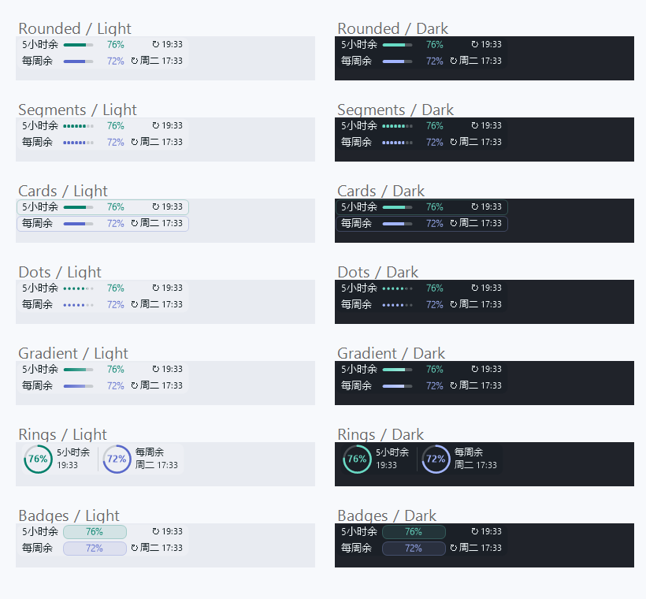
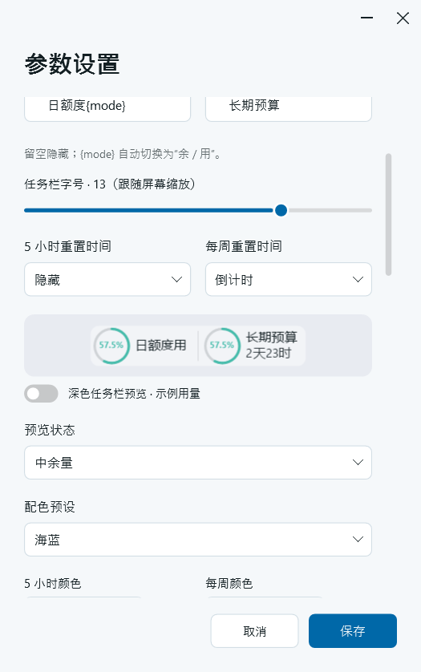
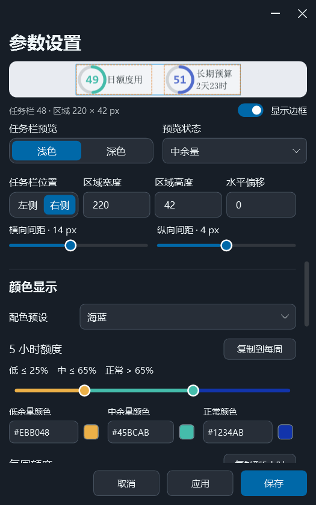

# Codex Usage Widget

当前源码版本：**3.0.1** · [更新记录](CHANGELOG.md)

一个轻量的 Windows 任务栏 Codex 用量组件。通过本机已登录的 Codex 后台程序读取账号额度，显示 **5 小时**和**每周**用量、进度及重置时间。

[下载 Release](https://github.com/CodeWithiYouth/codex-usage-widget/releases/latest)

使用 C#、WPF、WinForms 和 Windows 自带的 .NET Framework 4.8。组件本身无需 Node.js、Visual Studio、WinUI 或 Windows App SDK；编译生成一个约 160 KiB 的 Windows x64 EXE，不捆绑运行库。

以下功能说明对应当前源码，已发布的 Release 可能与当前开发版本不同。

## 运行环境

- Windows 10 22H2 或 Windows 11，x64。
- .NET Framework 4.8。
- 本机已登录的 Codex CLI，或包含可调用 Codex 后台组件的官方桌面应用。

目前实机验证环境为 Windows 11、125% 缩放；绘制检查覆盖 100%、125%、150%、200% 缩放。Windows 10 和跨显示器 DPI 切换仍需实机确认。组件嵌入 Explorer 任务栏，第三方任务栏工具或系统更新可能影响布局。

## 启动与使用

下载 EXE 后双击运行，或解压便携 ZIP 后运行 `Start.cmd`。默认隐藏详细窗口，只显示任务栏组件。

- 双击组件：打开详细窗口。
- 右键组件：刷新、打开参数设置或退出。
- 关闭或最小化详细窗口：隐藏窗口，后台继续刷新。
- 右键选择“退出”：关闭整个程序。

也可使用启动参数：

```powershell
.\dist\CodexUsageWidget-Windows.exe --settings
.\dist\CodexUsageWidget-Windows.exe --window
```

首次运行会自动查找可用的 Codex 后台程序。若无法连接，可在“数据源”中点击“自动检测”，或手动填写完整 EXE 路径，再点击“应用”。

## 任务栏样式

提供七种显示样式：圆角进度条、分段进度条、双行卡片、点阵进度、柔和渐变、环形仪表和数字胶囊。



图中使用 280 × 42 像素区域，放大两倍展示；数字字体为 Bahnschrift，圆环显示数值、横向间距为 16 像素，其余样式显示比例、纵向间距为 4 像素。

可以切换“剩余 / 已用”，该选项同时作用于任务栏和详细窗口。悬停提示显示两种额度的数值、重置时刻及最后更新时间。

圆环采用左右排列，数值按实际字形边界居中，标题和分行的重置时间按可见字形左边界对齐。两组使用固定的等宽区域，文字内容变化不会移动圆环；其他样式的标题和时间列也采用固定宽度。

## 参数设置

设置页分为 **任务栏设置、颜色显示、窗口设置、数据源** 四个区块。顶部预览固定，下面的参数独立滚动。

- **应用**：保存并立即生效，保持设置窗口打开。
- **保存**：保存并立即生效，然后关闭设置窗口。
- **取消**：放弃上次应用之后的未应用修改。



### 即时预览

预览可切换浅色、深色，并选择示例用量、高余量、中余量、低余量、数据过期或未连接状态。

| 余量示例 | 5 小时 | 每周 |
| --- | --- | --- |
| 高余量 | 82% | 81% |
| 中余量 | 51% | 49% |
| 低余量 | 13% | 11% |

这些数值为固定的剩余量示例。切换到“已用”时显示对应已用量；颜色仍由当前设置的剩余量阈值决定。

修改区域宽度或高度会即时改变预览。宽度支持 200–380 像素，高度支持 24–64 像素（默认 42）；实际高度受当前任务栏可用高度限制，预览外层高度固定为当前系统任务栏高度，内部控件区域按设置高度居中绘制；改变区域高度只改变控件与上下留白，不改变预览外层高度。受任务栏限制时标注“高度受限”，预览中的尺寸标签同时显示任务栏与控件区域尺寸。系统任务栏高度变化后，预览会自动更新。“显示边框”用于确认区域和间距：蓝色外框表示整体区域，橙色虚线表示两组控件范围。边框只在预览显示。

### 任务栏设置

| 选项 | 说明 |
| --- | --- |
| 显示方式 | 剩余 / 已用 |
| 显示样式 | 七种任务栏样式 |
| 数值显示 | 显示比例（如 `76%`）/ 显示数值（如 `76`）/ 全部隐藏 |
| 圆环粗细 | 1–6，默认 3，仅圆环样式使用 |
| 额度前缀 | 两组分别设置；`{mode}` 自动替换为“余 / 用”，留空隐藏 |
| 文字、数字、中文字体 | 分别选择字体 |
| 文字字号 | 10–14 |
| 百分比字号 | 8–20；受实际空间限制时自动缩小 |
| 重置时间 | 两组分别选择星期＋时刻、时刻、倒计时、日期＋时刻、日期或隐藏 |
| 任务栏位置 | 左侧 / 右侧，默认右侧 |
| 区域宽度 | 200–380 像素，默认 220 |
| 区域高度 | 24–64 像素，默认 42；实际高度受任务栏可用高度限制 |
| 水平偏移 | −1200 至 1200 像素 |
| 横向间距 | 0–32 像素，默认 10，用于圆环左右两组之间的间距 |
| 纵向间距 | 0–8 像素，默认 0，用于其他样式上下两行之间的间距 |

任务栏位置、区域宽度、区域高度和水平偏移在同一行，横向与纵向间距并排显示。根据当前样式启用适用的间距选项；纵向间距在设置的区域高度内调整。

隐藏数值后保留进度图形，数字胶囊改用进度条。圆环中放不下的日期时间会自动分行。

文字与数字字体可选微软雅黑 UI、Segoe UI、Arial、Consolas、Bahnschrift；中文字体可选微软雅黑 UI、微软雅黑、宋体、黑体、楷体、仿宋。界面默认使用微软雅黑 UI 和简体中文语言设置。圆环数字采用保留重叠笔画的填充方式，避免 Bahnschrift 的“4”在交叉处出现空洞。

停靠位置由左侧 / 右侧和水平偏移控制。需要避开天气、搜索栏或其他任务栏内容时，可手动调整水平偏移。

### 颜色显示

配色预设的标题与选择框左右排列。提供自动配色，以及薄荷与靛蓝、海蓝、暮紫、暖橙、森林与金砂、玫瑰与烟紫、冰川与湖蓝、石墨与银灰八组配色，也可自定义。



5 小时和每周额度各自拥有：

- 一条双端点阈值滑杆，分别调整低余量与中余量阈值。
- 滑杆下方对应排列的低、中、正常三种颜色。
- 一次性“复制到另一组”按钮，复制两个阈值与三种颜色，复制后仍可独立修改。

文字、背景和过期颜色共用。点击色块直接选色，也可输入 `#RRGGBB`；`Auto` 按任务栏深浅色自动解析。预设同时更新两组的三档颜色，色块、阈值条和实际任务栏使用相同的颜色规则。背景不透明度可设为 0–100%，0% 为全透明。

颜色始终按**剩余量**判定，切换到已用量不会改变判色规则。两组默认低阈值为 20%、中阈值为 50%：

| 剩余量 | 使用颜色 |
| --- | --- |
| ≤ 20% | 低余量颜色 |
| > 20% 且 ≤ 50% | 中余量颜色 |
| > 50% | 正常颜色 |

过期颜色优先于上述颜色：查询失败，或距上次成功更新超过 `max(120 秒, 刷新间隔 × 2)` 时使用。额度到达重置时刻本身不会触发过期颜色，也不会自动把额度设为 100%。

拖动滑杆端点或使用方向键可调整阈值，中阈值不能低于低阈值。旧配置的共用阈值和警告颜色会作为两组初始设置保留。

### 窗口设置

“开机自启动”位于设置页顶部“参数设置”标题右侧，滚动时保持可见。“始终置顶”和“启动时不展开详细窗口”位于窗口设置区块顶部。窗口样式可选实色 / 透明，窗口主题可选系统 / 浅色 / 深色。

“开机自启动”默认关闭，点击“应用”或“保存”后生效：开启后在当前用户登录 Windows 时自动运行，关闭后移除本程序的启动项，无需管理员权限。启动后是否展开详细窗口，仍由“启动时不展开详细窗口”控制。启动项使用当前 EXE 的完整路径；移动程序后，请在新位置运行程序并重新启用。若在 Windows 任务管理器中禁用了启动项，还需在那里重新启用。

窗口宽度为 320–520，高度为 390–650；透明模式可调整整窗不透明度，范围为 50–100%。

### 数据源

刷新间隔采用标签与窄输入框同行，默认 60 秒，可设为 15–3600 秒。

Codex 路径标题右侧的“自动检测”按钮会查找并填入可用后台程序路径，点击应用或保存后生效。留空时仍会在运行时自动检测。

## 用量来源与配置

路径非空时优先使用指定的完整 EXE 路径；留空时依次检查：

1. npm 安装位置和 PATH 中的 `codex.exe`。
2. `%LOCALAPPDATA%\OpenAI\Codex\bin\*\codex.exe`。
3. 当前用户注册的已知官方商店包内的 Codex 后台程序。

商店包信息使用 Windows 原生接口查询，不依赖 `Get-AppxPackage`；自动候选需通过 `app-server --help` 验证。

程序通过 `account/rateLimits/read` 获取额度，按刷新间隔更新，收到额度更新通知时再查询。倒计时每秒更新，用量按服务端返回值更新。不会执行模型任务。

配置写入 EXE 同目录的 `settings.json`，程序不保存登录令牌。显示的是所选后台程序登录账号的额度；普通 OpenAI API Key 用量与 ChatGPT 套餐额度不同，本程序没有直接 HTTP API 回退。若商店包不含可调用的后台组件，需安装并登录 Codex CLI。

## 从源码构建

在项目目录打开 Windows PowerShell：

```powershell
.\build.ps1
.\dist\CodexUsageWidget-Windows.exe
```

脚本使用 Windows 自带的 .NET Framework C# 编译器，无需下载项目依赖，生成 `dist\CodexUsageWidget-Windows.exe`。如果执行策略禁止脚本，可仅对本次进程运行：

```powershell
powershell.exe -NoProfile -ExecutionPolicy Bypass -File .\build.ps1
```

本地打包：

```powershell
.\package.ps1
# 也可显式指定，须与已编译 EXE 的版本一致
.\package.ps1 -Version v3.0.1
```

先构建再打包，默认从 EXE 读取版本，文件生成于 `dist\release\v3.0.1\`，包括独立 EXE、带版本号的便携 ZIP、说明、截图和 `SHA256SUMS.txt`。打包时会检查源码与 EXE 版本一致，避免旧程序被标记成新版本。

## 版本管理

`AppVersion.cs` 是程序版本来源，当前为 `3.0.1`；程序集和文件版本为 `3.0.1.0`，产品版本为 `3.0.1`。设置窗口标题行最右侧显示 `V3.0.1`。升级版本时修改 `AppVersion.cs` 中的版本，并同步 `app.manifest`；构建脚本会验证两者一致。更新记录维护在 `CHANGELOG.md`。

## 验证

```powershell
# 基础检查，无需登录或联网
.\test.ps1

# 外观、DPI 和实际设置窗口检查，会短暂打开测试窗口
.\test.ps1 -Appearance

# 读取本机真实用量，无模型请求
.\test.ps1 -Live
.\test.ps1 -Live -StoreOnly
```

检查报告与测试图片写入 `dist\`。外观检查覆盖旧配置兼容、全部配色预设的深浅色一致性、独立阈值与颜色复制、七种样式、字体与圆环字形、文字对齐、横纵间距、完整宽高、固定系统任务栏高度的预览、任务栏高度限制与边框预览、DPI 和应用/保存行为。

## 源码结构

| 文件 | 职责 |
| --- | --- |
| `AppVersion.cs` | 统一程序版本常量 |
| `Data.cs` | 配置、用量数据和 Codex 后台通信 |
| `CliLocator.cs` | 查找可用的 Codex 后台程序 |
| `MainWindow.cs` | 详细窗口、刷新和应用生命周期 |
| `SettingsWindow.cs`、`ThresholdRange.cs` | 参数设置、即时预览和双端点阈值控件 |
| `EmbeddedMeter.cs`、`MeterRenderer.cs` | 任务栏挂载、布局与绘制 |
| `Taskbar.cs` | 任务栏状态和悬停提示 |
| `UI.cs`、`Styles.cs` | 共用界面组件、字体和控件样式 |
| `AppearanceChecks.cs` | 外观与设置集成检查 |

运行时配置、真实用量报告、编译产物和本机缓存均不纳入 Git。

本项目是独立的个人工具，与 OpenAI 官方产品无隶属关系。
